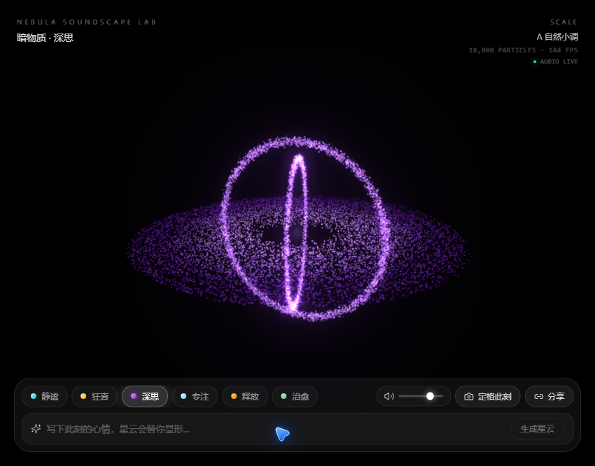

# 星云声景实验室 · Nebula Soundscape Lab

> 2026 Qoder 高校创造力大赛 · LifeHack 赛道
> 纯前端、零后端、点开即玩的星云主题实时视听交互与情绪生成式玩具。



---

## 一、快速开始

```bash
npm install
npm run dev      # http://localhost:5173
npm run build    # 产物在 dist/，可直接部署到 Qoder Sites
npm run preview  # 本地预览生产构建
```

环境要求：Node 18+。构建产物为纯静态文件，`base: './'` 已配置为相对路径，任意静态托管均可直接访问。

---

## 二、技术栈

| 层 | 选型 |
| --- | --- |
| 框架 | React 18 + TypeScript + Vite 5 |
| 样式 | Tailwind CSS 3（玻璃拟态 / 动效） |
| 3D | Three.js r171（自定义 ShaderMaterial 粒子 + UnrealBloomPass） |
| 音频 | 原生 Web Audio API（振荡器 / 滤波器 / 延迟 / AnalyserNode FFT） |
| 图标 | lucide-react |

零外部音频文件、零鉴权后端、零字体与 CDN 依赖。

---

## 三、目录结构

```text
src/
├── audio/
│   ├── NebulaAudioEngine.ts   # Web Audio 合成器、音阶生成与 FFT Analyser（单例）
│   └── scales.ts              # 情绪调式音阶与频率映射表
├── visual/
│   ├── NebulaCanvas.tsx       # Three.js 场景生命周期、双缓冲形变调度与交互绑定
│   ├── shapeGenerators.ts     # 纯数学点云生成器：六大情绪的专属天体几何拓扑
│   ├── nebulaShaders.ts       # 顶点/片元着色器（形变旋涡、分形态物理、Simplex 湍流）
│   └── presets.ts             # 六大情绪星系的拓扑 / 物理 / 机位 / 声学配置
├── utils/
│   ├── emotionParser.ts       # 本地中英文心情文本多维情感向量解析器
│   ├── postcardGenerator.ts   # 离屏 Canvas 合成星云声波明信片 PNG
│   └── urlState.ts            # URL Hash 状态序列化（LZW + Base64URL）
├── components/
│   ├── LaunchOverlay.tsx      # 首屏奇点唤醒遮罩（解锁 AudioContext）
│   ├── ControlDock.tsx        # 底部悬浮玻璃拟态控制栏
│   └── PostcardModal.tsx      # 明信片预览、下载与分享链接复制
├── App.tsx
├── main.tsx
└── index.css
```

---

## 四、实现要点

### 1. 六大情绪的专属几何拓扑

`src/visual/shapeGenerators.ts` 是纯数学点云生成器，`generateNebulaShape(type, count): Float32Array`
返回 `count × 3` 坐标；六种拓扑共用同一坐标约定（Y 轴向上），跨度统一归一化在半径 ~3.5 内：

| 预设 | 天体拓扑 | 关键构造 |
| --- | --- | --- |
| 静谧 `serenity` | 蝴蝶双叶星云 | 沿 X 轴左右对称双翼，`sin^0.75` 包络收腰、翼尖收成尖角，翼面叠三层丝绸状正弦波纹并上扬 |
| 狂喜 `euphoria` | 超新星爆炸残骸 | 75% 双层中空纤维球壳（r 2.45 / 2.98 + 3D 褶皱）+ 25% 八向高能喷流（4 方位角 × 上下锥） |
| 深思 `melancholy` | 黑洞吸积盘 | r < 0.75 绝对空心视界；70% 极薄水平吸积盘（0.75–3.6）；30% 竖直爱因斯坦环（主环绕 Y 偏转 20°） |
| 专注 `focus` | 脉冲星磁感线 | 15% 致密亮核 + 35% 倾斜 25° 磁轴的极窄双极光束 + 50% 三组偶极子磁感线 `r = L·sin²θ` |
| 释放 `catharsis` | 红巨星日冕环 | 60% 强湍流恒星球体 + 40% 六条固定参数的二次贝塞尔日珥磁拱（拱起又回落） |
| 治愈 `healing` | 创生之柱 | 三塔 h = 3.6 / 2.7 / 1.9，柱身螺旋收窄带有机凹凸，顶端 12% 聚集高亮气态球 |

每个 builder 同时输出 `size / seed / role / colorT` 四个逐粒子属性：
`role` 是结构角色权重（驱动形变旋涡强度与差速自转），`colorT` 是 0 内核 → 1 外晕的颜色梯度参数。

### 2. 双缓冲形变（GPU Morph）

- `BufferGeometry` 同时挂 `position`（当前）与 `aTargetPosition`（目标），并配 `aSize/aTargetSize`、
  `aRole/aTargetRole`、`aColorT/aTargetColorT` 四对缓冲。
- 切换预设时把新形态写入目标缓冲，`uMorphProgress` 在 **1.5s** 内 0 → 1；顶点着色器按 cubic ease-in-out 插值，
  并在过渡中段叠加 `sin(p·π)` 的绕 Y 轴旋涡扭转（角度 `tw·(1.15 + role·2.4)`，另加 y 向抖动与 14% 收缩），
  粒子以星尘旋涡轨迹重组。
- 过渡结束 `finalizeMorph()` 把目标缓冲整体拷回当前缓冲并把 `uMorphProgress` 归零，稳态零插值开销。
- 同一预设只改情绪时不重建几何（`shapeChanged = preset.id !== shapeId`），避免无谓形变。

### 3. 分形态动态物理 `uBehavior`

`uBehavior = vec4(spin, pulse, drift, turbulence)`，各预设在 `presets.ts` 给出专属基线，
运行时按 `1 - exp(-dt·2.4)` 平滑趋近：

| 分量 | 规律 | 形态差异 |
| --- | --- | --- |
| `x` 自转 | `ω = spin·(1 + shear·role / (0.35 + r))` 开普勒差速 | melancholy `shear = 2.4` 内快外慢；healing 仅 0.02 |
| `y` 径向脉冲 | 随 `uBass` 呼吸 | euphoria 0.22 最强，melancholy 0.06 |
| `z` 垂直升腾 | 每粒子按种子错相位上升并淡出 | 仅 healing 0.16，柱体持续升腾飘散而不散架 |
| `w` 湍流 | Simplex 噪声位移 | catharsis 0.20 最乱，melancholy 0.05 |

心情解析得到的湍流 / 转速以相对倍率叠加到基线上（`setMotion`），不会覆盖形态自身的性格。

### 4. 相机最佳机位过渡

每个预设给出 `camera = { phi, theta, dist }`：切换时相机按 `1 - exp(-dt·2.2)` 平滑移动到该形态的
最佳俯仰角 / 方位角 / 距离（如 melancholy 以 18° 俯视同时看到吸积盘与透镜环，serenity 以 54° 俯视展开双翼），
方位角取最短旋转路径避免绕远路。用户一旦拖拽或滚轮，`userCam` 立即置位让出控制权，
直到下一次切换预设才收回。

### 5. 视听共振

每帧从 `AnalyserNode` 读取三段能量写入 uniform：

| Uniform | 频段 | 作用 |
| --- | --- | --- |
| `uBass` | 20–150 Hz | 核心呼吸膨胀、核心辉光与 Bloom 强度 |
| `uMid` | 150–2000 Hz | 旋臂湍流幅度 |
| `uTreble` | 2000 Hz+ | 外围星尘高频闪烁 |

### 6. 交互

| 操作 | 反馈 |
| --- | --- |
| 鼠标拖拽 | 球坐标视角旋转，带惯性衰减；同时 `userCam = true`，立即接管相机（预设机位不再抢权） |
| 悬停 | 3D 空间投影点生成局部引力旋涡（径向吸附 + 切向搅动），并触发轻微高频泛音 |
| 长按（>240ms 未移动） | 粒子向中心坍缩，`startRiser()` 音调平滑上扬 |
| 松开 | 超新星爆发：球面冲击波 + 低频冲击 + 噪声气浪 + 调式和弦琶音 |
| 单击 | 局部星簇光脉冲 + 随机音阶泛音 |
| 键盘 `A S D F G H J K L` | 点亮随机星簇（`uBurstPos`）+ 演奏当前调式音阶风铃音 |
| 滚轮 | 相机推拉（5 – 24），同样置位 `userCam` |

### 7. 程序化星际合成器

`NebulaAudioEngine` 为单例，四层架构：

1. **Ambient Drone**：3 个振荡器（sine ±6¢ / triangle）+ 低通 + 0.05 Hz LFO。
2. **Generative Chimes**：按预设 BPM 的八分音符 lookahead 调度，马尔可夫音级游走（偏好小音程），
   立体声反馈延迟（0.375s / 0.52s，交叉反馈 + 低通阻尼）模拟宇宙混响。
3. **Interactive Synth**：FM 钟琴音色，Attack 15ms / Release 1.8s。
4. **Solar Wind**：Paul Kellet 粉红噪声 Buffer + 带通滤波，随星云转速调整风声。

> 浏览器自动播放合规：首屏 `IGNITE NEBULA` 按钮内执行 `audioContext.resume()`，
> 主增益从 0.0001 用 2.4s 指数淡入，杜绝爆音。

### 8. 情绪引擎

- 词典覆盖中英文约 200 个词条，三维打分：**Valence 效价 / Arousal 唤醒度 / Mystery 神秘感**。
- 否定词（不 / 没 / 无 / 非 / not / never…）反转效价并提升神秘感；
  程度副词（非常 / 特别 / very / extremely…）与弱化词（有点 / 稍微 / a bit…）做权重乘法。
- 输出连续向量 → 最近邻匹配六大星系 → 生成情绪调色板并与预设色 50% 混合 →
  派生湍流 / 转速 → 生成一句「星云观测日志」。
- 所有参数在 1.5s 内平滑插值（`1 - exp(-dt·2.7)`）。

### 9. 明信片与分享

- `WebGLRenderer` 开启 `preserveDrawingBuffer: true`，`composer.render()` 后 `toDataURL()` 截图。
- 离屏 2D Canvas 合成 1080×1350 玻璃拟态卡片：星云图 + 心情短句 + 星系名 / 音阶 +
  对数频谱条 + 时间戳。
- URL Hash：`{ presetId, customText, colors, turbulence, speed, seed, emotion }`
  → JSON → **LZW 压缩** → **Base64URL** → `#nebula=eyJ...`；
  初始化时反解并 100% 还原，解压失败自动回退明文 Base64。

---

## 五、验收对照

### 阶段一 · 视觉底座
- [x] 全屏 18,000 粒子星云（桌面端），移动端 / 低帧率自动降至 8,000
- [x] 鼠标拖拽视角、悬停引力扰动
- [x] 长按坍缩 → 松开超新星爆发
- [x] 稳定 60 FPS（实测 144 FPS @ 850×667，DPR 2）

### 阶段二 · 声景与视听联动
- [x] 点击唤醒后声音平滑淡入（无爆音）
- [x] 低频驱动核心脉动 + Bloom 泛光
- [x] 键盘 `A–L` 流畅弹奏星辰泛音
- [x] 六大预设各自独立调式 / BPM / 湍流 / 转速

### 阶段三 · 情绪引擎与分享闭环
- [x] 切换 6 大预设或输入任意心情文本，颜色 / 形态 / 音阶 1.5s 内渐变
- [x] 定格生成完整明信片并下载 PNG
- [x] 复制链接在新标签页打开 100% 复现（已实测：预设、文本、配色、音阶全部还原）

### 改造 · 六大专属拓扑与双缓冲形变
- [x] `generateNebulaShape(type, count)` 导出 6 套截然不同的天体几何（蝴蝶 / 超新星 / 黑洞 / 脉冲星 / 红巨星 / 创生之柱），
      跨度统一归一化在半径 ~3.5 内（实测包围盒见下）
- [x] `aTargetPosition` + `uMorphProgress` 双缓冲形变，1.5s cubic ease-in-out + 中段 `sin(p·π)` 旋涡扭转，
      结束后目标缓冲同步回 `position`
- [x] `uBehavior` 四类分形态物理（melancholy 强开普勒差速、healing 持续升腾飘散等）
- [x] 切换预设时相机平滑移动到形态最佳俯仰角；用户拖拽 / 滚轮立即让权（实测 `userCam: true` 后不再跟随）
- [x] 零回退：FFT 频谱、悬停旋涡、长按坍缩 / 超新星、键盘星簇、明信片导出全部保留并实测通过

| 形态 | 包围盒 x / y / z（半径 ~3.5 内） |
| --- | --- |
| serenity | ±3.17 / -0.09~0.49 / -0.68~1.58 |
| euphoria | -3.10~3.32 / ±3.27 / ±3.25 |
| melancholy | ±3.60 / ±2.13 / ±3.59 |
| focus | ±3.27 / ±3.07 / ±3.06 |
| catharsis | -2.25~2.30 / ±1.81 / ±2.08 |
| healing | -2.95~2.55 / -1.16~2.79 / -0.94~1.16 |

---

## 六、调试

```js
// 控制台读取音频引擎状态
__nebulaAudio.ctx.state        // "running"
__nebulaAudio.getBands(0.016)  // { bass, mid, treble } 0~1
__nebulaAudio.getSpectrum(64)  // 频谱数组
```

## 七、部署

```bash
npm run build
```

将 `dist/` 目录上传至 Qoder Sites（或任意静态托管）即可公开访问。
分享链接使用 `history.replaceState` 写入 Hash，不产生服务端请求。
